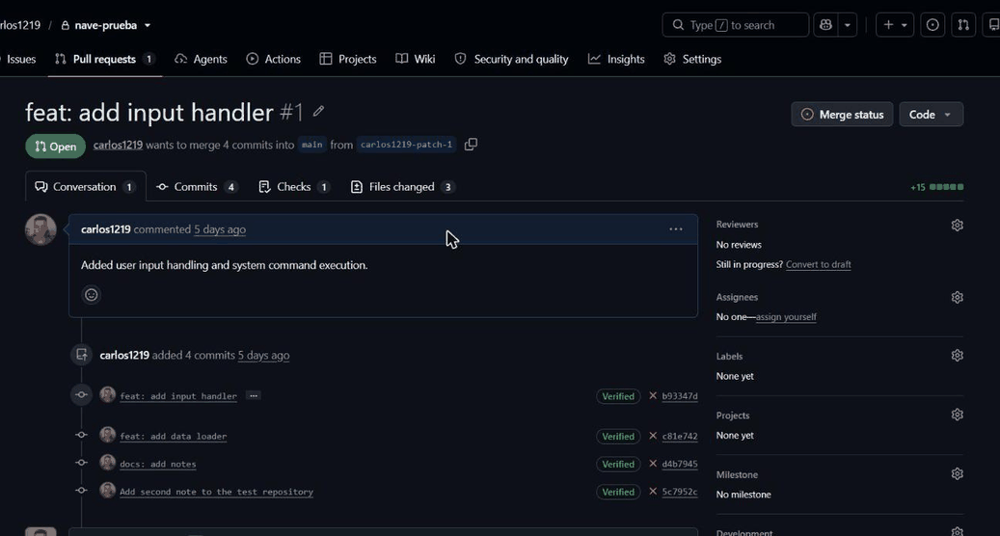

## 🔐 Sobre mí

Analista de seguridad de aplicaciones (AppSec) y desarrollador full stack en **Global Exchange**. Me muevo entre el código y la seguridad: diseño sistemas en los que la seguridad es una restricción de partida y no una revisión al final, con modelo de amenazas primero, mínimo privilegio, cadena de suministro verificable y pruebas contra sistemas reales.

- 🎓 Máster en Ciberseguridad
- 🛡️ Foco: AppSec, DevSecOps, seguridad en pipelines y contenedores

## 🚀 Proyecto destacado: [NAVE](https://github.com/carlos1219/nave)

Plataforma SAST/SCA para GitHub. Analiza cada push y pull request con **Semgrep** y **Trivy**, aplica una política de calidad y bloquea la PR con un check y un comentario cuando entra un fallo grave.

- **El escáner como superficie de ataque.** El código analizado no es de fiar: cada escaneo corre en contenedores efímeros sin red, con **gVisor** y Docker rootless, y solo un servicio aislado puede crearlos, mediante peticiones firmadas con HMAC.
- **Seguridad documentada y comprobada.** Modelo de amenazas STRIDE, 34 decisiones de arquitectura (ADR) y una revisión como atacante con 36 hallazgos, cada corrección con su test de regresión.
- **Cadena de suministro.** Imágenes fijadas por digest, dependencias con hash, acciones fijadas por SHA, SBOM CycloneDX, firma con cosign y OpenSSF Scorecard.
- **Calidad.** Unos 2.900 tests, arquitectura hexagonal verificada en CI y una CI que se escanea a sí misma.

## 🧰 Stack

Seguridad: Semgrep · Trivy · gVisor · Sigstore/cosign · OpenSSF Scorecard · CodeQL · Dependabot

## 🫀 Otro proyecto: BlutTruck

Sistema de monitorización cardíaca con IA (TFG): pulsera inteligente → app móvil (Dart) → backend **C# / .NET** → servidor de predicción en **Python** (SVM) → panel web en **Vue.js**, todo orquestado con **Docker**.

[`BlutTruckAPI`](https://github.com/carlos1219/BlutTruckAPI) · [`BlutTruck_Conjunto2`](https://github.com/carlos1219/BlutTruck_Conjunto2)

## 🤖 Cómo trabajo

Uso asistentes de IA (Claude Code) bajo un contrato de ingeniería escrito con reglas de seguridad no negociables. La arquitectura, las restricciones y los riesgos aceptados los decido yo, y nada se da por bueno sin tests, CI y pruebas contra el sistema real, incluido el código que propone el asistente.
